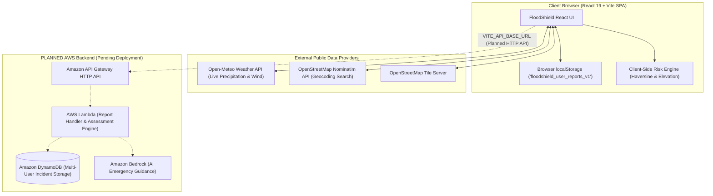

# FLOODSHIELD — Environmental Intelligence & Early-Warning Platform

FloodShield is an AI-powered hyperlocal flood and waterlogging early-warning web application designed for environmental intelligence, citizen safety reporting, and disaster mitigation during extreme weather events.

---

## A. PROJECT OVERVIEW

Urban coastal centers and low-lying cities face severe waterlogging, sudden street flooding, and delayed emergency information during heavy monsoon downpours. FloodShield bridges this critical gap by unifying live atmospheric weather observations, citizen-reported flood incidents, interactive topographic mapping, and intelligent response assistance into a single unified interface.

### Current Working Capabilities
- **Hyperlocal Atmospheric Monitoring**: Live weather observations (precipitation rates in mm/hr, temperature, wind speed, atmospheric pressure) fetched dynamically via the Open-Meteo public API.
- **Interactive Topographic Atlas**: Leaflet + OpenStreetMap interactive mapping centered on low-lying urban areas (e.g., Mumbai), featuring Nominatim geocoding location search, radius filtering (5 km, 10 km, 25 km, ALL), and national map fitting.
- **Citizen Incident Reporting & Persistence**: Fully functional report submission flow with strict coordinate integrity (GPS auto-detection, Nominatim geocoding, or explicit `null` setting for unlocated reports). Reports persist reliably across browser sessions in `localStorage` under key `floodshield_user_reports_v1`.
- **Coordinate Integrity & Marker Exclusion**: Reports with valid numeric coordinates render as interactive Leaflet map pins; unlocated reports appear in the telemetry panel list but are excluded from geographic map pins and Haversine radius filters.
- **Scenario Simulation Laboratory**: Interactive elevation, rainfall rate, and drain efficiency simulation lab for modeling urban surface water accumulation.
- **Emergency Safe Passage Checklist**: Routing hazard checklist with elevation indicators and strict safety disclaimers.

### Technology Stack
- **Frontend Core**: React 19, Vite 8, JavaScript (ES modules)
- **Map & Geospatial**: Leaflet 1.9, React-Leaflet 5, OpenStreetMap Tiles, Nominatim Geocoding API
- **Live Weather Data**: Open-Meteo Atmospheric Forecast API
- **Icons & UI**: Lucide-React icons, custom CSS Design System (Obsidian `#090A0A` theme with Signal Orange `#FF6438` and Acid Lime `#C7F36B` accents)
- **Local Persistence**: Browser `localStorage` API
- **Containerization**: Multi-stage Docker build with Nginx Alpine

---

## B. FEATURE STATUS

| Feature Module | Current Implementation Status | Real Data / Backend Status |
| :--- | :--- | :--- |
| **Flood Atlas (`/atlas`)** | **Implemented**: Leaflet map, radius filtering, search, map markers, location recentering | Live Open-Meteo weather feed; local user reports rendered from `localStorage` |
| **Incidents Telemetry (`/incidents`)** | **Implemented**: Scrollable report feed, category filtering, clear local reports procedure | Displays locally saved citizen reports; server aggregation pending AWS backend |
| **Response Copilot (`/copilot`)** | **Implemented**: Tactical advice UI, quick prompt shortcuts, client-side fallback responses | Full LLM inference pending AWS Bedrock & API Gateway deployment (`POST /assess`) |
| **Scenario Lab (`/scenario-lab`)** | **Implemented**: Interactive risk slider matrix and runoff accumulation engine | Outputs are explicitly labeled as mathematical simulations, not live measurements |
| **Safe Passage (`/safe-passage`)** | **Implemented**: Route selection UI, elevation checklist, safety warnings | Displayed routes include strict disclaimers ("ROUTE SAFETY UNVERIFIED BY MUNICIPAL TELEMETRY") |
| **Report Incident (`/report`)** | **Implemented**: GPS auto-detect, Nominatim geocoding, localStorage persistence | Reports are saved locally to the browser profile (`floodshield_user_reports_v1`) |

> [!IMPORTANT]
> **Data Integrity Notice**: Browser `localStorage` reports are local to your current browser profile and device. Multi-user report synchronization, official municipal stream gauge telemetry, and automated flood verification require the planned AWS backend.

---

## C. ARCHITECTURE



---

## D. TECHNOLOGY TABLE

| Technology | Category | Role in FloodShield |
| :--- | :--- | :--- |
| **React 19** | UI Library | Core component-driven web user interface |
| **Vite 8** | Build Tool & Dev Server | Fast HMR development server and ESBuild static bundler |
| **Leaflet / React-Leaflet** | Geospatial / Mapping | Interactive map display, tile rendering, custom markers |
| **Open-Meteo API** | External Weather Feed | Live real-time atmospheric precipitation and weather data |
| **Nominatim API** | External Geocoding | Converts user location queries into numeric coordinates |
| **Lucide React** | Iconography | Lightweight vector icons for operational UI |
| **Nginx Alpine** | Production Web Server | Static production asset hosting & SPA history routing fallback |
| **Docker** | Containerization | Multi-stage image build for portable cloud deployment |

---

## E. PREREQUISITES

### Local Development Prerequisites
- **Node.js**: v18.0.0 or higher (v20.x recommended)
- **npm**: v9.0.0 or higher
- **Git**: v2.x

### Containerization Prerequisites (Optional)
- **Docker Engine**: v24.0+ or Docker Desktop
- **Docker Compose**: v2.20+

---

## F. LOCAL SETUP (WINDOWS POWERSHELL)

Follow these exact steps to clone, configure, and launch FloodShield on Windows:

```powershell
# 1. Clone the repository
git clone https://github.com/<your-username>/FloodShield.git

# 2. Change into the project directory
cd FloodShield

# 3. Install dependencies using package-lock.json
npm ci

# 4. Create local environment configuration from template
Copy-Item .env.example .env

# 5. Start the Vite local development server
npm run dev

# 6. Open your browser and navigate to the printed local URL:
# http://localhost:5173

# 7. Run the production build to verify static bundling
npm run build
```

---

## G. ENVIRONMENT VARIABLES

FloodShield uses Vite standard client-side environment variables (`VITE_*`).

| Variable Name | Purpose | Required? | Example Value | Scope |
| :--- | :--- | :--- | :--- | :--- |
| `VITE_API_BASE_URL` | Base URL of AWS API Gateway HTTP API endpoint | Optional | `https://abc123xyz.execute-api.us-east-1.amazonaws.com` | Build time |
| `VITE_USE_MOCK_DATA` | Switcher to toggle client-side mock/local mode | Optional | `true` | Build time |
| `VITE_APP_ENV` | Target environment label | Optional | `hackathon` | Build time |

### Fallback Behavior
If `VITE_API_BASE_URL` is left empty or the target backend endpoint is unreachable:
1. `apiClient.js` gracefully handles connection timeouts.
2. Atmospheric weather data automatically falls back to live public Open-Meteo API queries.
3. Incident reports are stored and retrieved from browser `localStorage`.
4. Copilot responses operate using structured client-side emergency guidance.

---

## H. DOCKER SETUP

FloodShield includes a production multi-stage `Dockerfile` and Nginx configuration for hosting the SPA static bundle.

### 1. Build the Docker Image
```powershell
# Build image without backend API URL (Local/Fallback mode)
docker build -t floodshield:latest .

# Build image with custom AWS API Gateway URL
docker build --build-arg VITE_API_BASE_URL="https://your-api-id.execute-api.us-east-1.amazonaws.com" -t floodshield:latest .
```

### 2. Run the Container
```powershell
# Run container mapping host port 8080 to container port 80
docker run -d --name floodshield-app -p 8080:80 floodshield:latest
```

Open `http://localhost:8080` in your web browser.

### 3. Container Management Commands
```powershell
# View container logs
docker logs -f floodshield-app

# Check container health status
docker inspect --format='{{json .State.Health}}' floodshield-app

# Stop and remove container
docker stop floodshield-app
docker rm floodshield-app
```

### 4. Running with Docker Compose
```powershell
# Start frontend container using Docker Compose
docker compose up -d --build

# Stop container stack
docker compose down
```

### Known Docker Limitations
Because Vite environment variables (`VITE_*`) are statically embedded into JavaScript bundles during `npm run build`, changing `VITE_API_BASE_URL` requires rebuilding the Docker image (`docker build --build-arg ...`).

---

## I. BACKEND INTEGRATION CONTRACT (PLANNED AWS API GATEWAY)

When the AWS backend teammate deploys the API Gateway HTTP API, the frontend will connect using `VITE_API_BASE_URL`. Below is the agreed endpoint specification:

### 1. `GET /health`
- **Purpose**: Verifies backend availability and database connection health.
- **Expected Response (`200 OK`)**:
  ```json
  {
    "status": "OK",
    "service": "FloodShield AWS API Gateway",
    "timestamp": "2026-10-10T15:00:00.000Z"
  }
  ```

### 2. `POST /reports`
- **Purpose**: Persists a citizen-submitted incident report into Amazon DynamoDB.
- **Request Body (`application/json`)**:
  ```json
  {
    "title": "Waterlogging near Bridge",
    "location": "Lower Parel, Mumbai",
    "category": "Waterlogging",
    "lat": 19.0012,
    "lng": 72.8294,
    "waterDepthCm": 35,
    "severity": "HIGH",
    "description": "Submerged road section.",
    "photoUrl": null
  }
  ```
- **Expected Response (`201 Created`)**:
  ```json
  {
    "success": true,
    "ticket": {
      "id": "INC-1728572400-842",
      "title": "Waterlogging near Bridge",
      "timestamp": "2026-10-10T15:00:00.000Z",
      "status": "SUBMITTED"
    }
  }
  ```

### 3. `GET /reports`
- **Purpose**: Retrieves multi-user verified citizen reports from Amazon DynamoDB.
- **Expected Response (`200 OK`)**:
  ```json
  {
    "reports": [
      {
        "id": "INC-1728572400-842",
        "title": "Waterlogging near Bridge",
        "location": "Lower Parel, Mumbai",
        "lat": 19.0012,
        "lng": 72.8294,
        "waterDepthCm": 35,
        "severity": "HIGH",
        "timestamp": "2026-10-10T15:00:00.000Z"
      }
    ],
    "count": 1
  }
  ```

### 4. `POST /assess`
- **Purpose**: Requests AI-assisted risk assessment and tactical response guidance via AWS Bedrock.
- **Request Body (`application/json`)**:
  ```json
  {
    "query": "Is it safe to drive near Hindmata flyover?",
    "lat": 19.0110,
    "lng": 72.8420
  }
  ```
- **Expected Response (`200 OK`)**:
  ```json
  {
    "assessment": "Severe waterlogging reported (40cm+ depth). Avoid low-lying underpasses.",
    "riskLevel": "HIGH",
    "recommendedActions": [
      "Divert via Dr. B.A. Road elevated flyover",
      "Do not attempt wading through standing water"
    ]
  }
  ```

---

## J. TROUBLESHOOTING

### 1. `npm install` or `npm ci` Failures
- Ensure Node.js version is `>= 18.0.0` (`node -v`).
- Clear npm cache if locks mismatch: `npm cache clean --force`.

### 2. Map Tiles Not Rendering
- Verify active internet connection (OpenStreetMap tiles require public network access).
- Check browser developer tools console for network blockages or CORS extensions interfering with tile requests.

### 3. Geolocation Auto-Detect Not Working
- Modern web browsers require a **Secure Context (`https://` or `http://localhost`)** to access `navigator.geolocation`.
- Ensure browser location permissions are granted for `localhost`.

### 4. Direct Refresh on Subpages Returns 404 in Production
- Ensure Nginx or your production web server has single-page application fallback enabled (`try_files $uri $uri/ /index.html;`). This is pre-configured in `nginx.conf`.

---

## K. SECURITY AND LIMITATIONS

1. **Environment Secrets**: Never commit `.env` files containing private credentials or keys. `VITE_*` variables are embedded into browser JavaScript bundles and are publicly readable by clients.
2. **Local Storage Scoping**: Browser `localStorage` is isolated per browser profile and device. It does not synchronize data between different devices or users.
3. **API Rate Limits**: Public services (Open-Meteo weather and Nominatim geocoding) enforce public usage policies and request rate limits.
4. **Non-Official Advisory Notice**: FloodShield citizen reports and simulation models are designed for informational hackathon demonstration purposes. Official municipal emergency instructions always take precedence during natural flood disasters.

---

## LICENSE

Distributed under the MIT License for environmental hackathon development.
