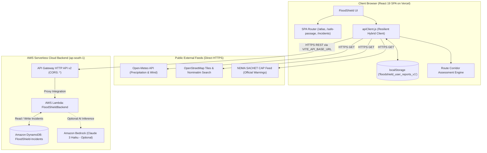

# FloodShield — Hyperlocal Environmental Intelligence & Flood-Aware Navigation

[](LICENSE)
[](https://vitejs.dev/)
[](https://aws.amazon.com/)
[](https://vercel.com/)

FloodShield is an AI-enhanced, environmental intelligence and hyperlocal flood-aware routing web platform designed for urban centers subject to extreme monsoon rainfall, flash floods, and coastal inundation.

---

## 1. Problem Statement & Purpose

Dense coastal metropolises (e.g., Mumbai, Chennai, Jakarta) experience acute localized waterlogging during torrential monsoon downpours. Conventional mapping platforms route vehicles into submerged underpasses and inundated arterials because municipal flood gauges are disconnected from public consumer maps.

FloodShield bridges this operational gap by synthesizing:
1. **Live Atmospheric Feeds**: Real-time precipitation rates and atmospheric telemetry from Open-Meteo.
2. **Official Government Feeds**: Disaster advisories parsed from the Indian National Disaster Management Authority (NDMA SACHET) Common Alerting Protocol (CAP) feed.
3. **Citizen Field Telemetry**: Crowdsourced flood reports persisted to Amazon DynamoDB with verified geographic coordinates, water depth, and triage status.
4. **Hazard-Aware Route Engine**: Dual-corridor evaluation that detects flood hazards along travel paths, preferring elevated terrain detours over low-lying underpasses.
5. **Scenario Lab**: Deterministic runoff accumulation modeling to simulate urban waterlogging under varying rainfall and tidal surge scenarios.

---

## 2. Core Capabilities & Feature Modules

| Module | Route | Capabilities & Real Data Feeds |
| :--- | :--- | :--- |
| **Flood Atlas** | `/atlas` | Interactive Leaflet/OSM map, Nominatim geocoding search, radius filtering (5 km, 10 km, 25 km, ALL), live Open-Meteo weather telemetry, and real-time hazard pin rendering with provenance markers. |
| **Safe Passage** | `/safe-passage` | Dynamic hazard-aware route assessment with dual-layer high-contrast polylines, 1.5 km corridor hazard scanning, clickable routes, side-panel hazard inspector, and transparent elevation terrain assumptions. |
| **Incidents Radar** | `/incidents` | Multi-category incident feed (Waterlogging, Road Blocked, Submerged Vehicle, Severe Drainage Failure), active triage dispatch actions, and provenance tracking (`AWS-SYNCED` vs `LOCAL-ONLY`). |
| **Report Portal** | `/report` | Citizen incident reporting with HTML5 GPS auto-detection, Nominatim reverse geocoding, water depth slider (cm), and two-tier persistence (AWS DynamoDB sync + local browser backup). |
| **Scenario Lab** | `/scenario-lab` | Hydrodynamic runoff simulation matrix modeling rainfall rate (mm/hr), storm surge (m), and drain efficiency (%) into peak water depth and time-to-inundation estimates. |
| **Response Copilot** | `/copilot` | Tactical emergency guidance assistant backed by AWS Lambda / Bedrock (`POST /assess`) with deterministic client-side decision support fallback. |

---

## 3. Technology Stack

### Frontend Architecture
- **Framework**: React 19, Vite 8, JavaScript (ES modules)
- **Mapping & Geospatial**: Leaflet 1.9, React-Leaflet 5, OpenStreetMap Tiles, Nominatim API
- **External Public Feeds**: Open-Meteo Forecast API (Rainfall, Wind, Pressure), NDMA SACHET CAP Feed
- **Design System**: Graphite/Obsidian (`#090A0A`) dark UI with Signal Orange (`#FF6438`) and Cyan (`#00E5FF`) accents, Lucide-React icons
- **State & Storage**: Client-side storage (`localStorage` fallback) with resilient cloud synchronizer
- **Hosting Target**: Vercel (Single Page Application with `vercel.json` rewrites)

### Backend Architecture (AWS Serverless)
- **API Gateway**: Amazon API Gateway v2 (HTTP API, low-latency, built-in CORS)
- **Compute**: AWS Lambda (Node.js 20.x ES Modules, 256MB memory, 15s timeout)
- **Database**: Amazon DynamoDB (`PAY_PER_REQUEST` On-Demand billing, 0 idle cost)
- **AI / Decision Support**: Amazon Bedrock (Claude 3 Haiku, optional) with deterministic fallback
- **Logging**: Amazon CloudWatch Logs with strict 7-day retention policy

---

## 4. System Architecture & Request Flow



### Hybrid Resilience Model
- **Cloud-Connected**: When `VITE_API_BASE_URL` is set and `VITE_USE_MOCK_DATA=false`, reports and status updates synchronize with Amazon DynamoDB via AWS API Gateway.
- **Graceful Fallback**: If network connectivity drops or the AWS endpoint is unavailable, `apiClient.js` falls back seamlessly to browser `localStorage` and client-side deterministic models. Incidents are transparently labeled `LOCAL-ONLY INCIDENT` or `AWS-SYNCED INCIDENT`.

---

## 5. Environment Variables & Configuration

FloodShield enforces strict separation between public browser variables and backend-only credentials:

### Frontend Environment Variables (Vite / Vercel)
All variables prefixed with `VITE_*` are bundled into client-side JavaScript. **Never put AWS credentials in these variables!**

| Variable | Scope | Required? | Default / Example | Purpose |
| :--- | :--- | :--- | :--- | :--- |
| `VITE_API_BASE_URL` | Public (Client Bundle) | Optional | `https://abcdef1234.execute-api.ap-south-1.amazonaws.com` | Base URL of deployed AWS API Gateway HTTP API. If empty, runs in standalone local mode. |
| `VITE_USE_MOCK_DATA` | Public (Client Bundle) | Optional | `false` (Production) / `true` (Demo) | Toggles between live cloud API calls and local offline mock data. |
| `VITE_APP_ENV` | Public (Client Bundle) | Optional | `production` | Environment indicator label (`production`, `staging`, `development`). |

### Backend Environment Variables (`backend/.env` — Backend / Lambda Only)
These variables are used by AWS Lambda and administrative scripts. **They must never be committed to Git or exposed in client bundles.**

| Variable | Scope | Description |
| :--- | :--- | :--- |
| `AWS_REGION` | Lambda Runtime | Target AWS region (default: `ap-south-1`). |
| `TABLE_NAME` | Lambda Runtime | DynamoDB table name (default: `FloodShield-Incidents`). |
| `ENABLE_BEDROCK` | Lambda Runtime | `true` or `false` to enable Amazon Bedrock AI inference. |
| `BEDROCK_MODEL_ID` | Lambda Runtime | Foundation model ID (e.g. `anthropic.claude-3-haiku-20240307-v1:0`). |
| `AWS_ACCESS_KEY_ID` | Local CLI Tools Only | For `deploy.mjs` / `check-permissions.mjs` execution from local workstation. In Lambda, IAM role policies grant access automatically. |
| `AWS_SECRET_ACCESS_KEY` | Local CLI Tools Only | Secret access key for local administrative CLI tools. |

---

## 6. Local Development Setup

### Prerequisites
- Node.js `>= 18.0.0` (v20.x LTS recommended)
- npm `>= 9.0.0`
- Git `>= 2.x`

### Step-by-Step Setup (PowerShell / Bash)

```bash
# 1. Clone the repository
git clone https://github.com/<your-username>/FloodShield.git
cd FloodShield

# 2. Install dependencies deterministically
npm ci

# 3. Create your local environment file from the safe template
cp .env.example .env
# On Windows PowerShell:
# Copy-Item .env.example .env

# 4. (Optional) Edit .env with your AWS API Gateway URL if connecting to cloud
# VITE_API_BASE_URL=https://abcdef1234.execute-api.ap-south-1.amazonaws.com
# VITE_USE_MOCK_DATA=false

# 5. Start the local Vite development server
npm run dev

# 6. Open http://localhost:5173 in your browser
```

---

## 7. Quality Assurance & Verification Commands

FloodShield includes a suite of unit tests validating API resilience, NDMA SACHET CAP parsing, date formatting, route corridor geographic filtering, and report status persistence:

```bash
# Run unit tests
npm test

# Verify production static build
npm run build

# Run linter
npx oxlint
```

---

## 8. Frontend Deployment to Vercel

FloodShield is pre-configured for deployment on [Vercel](https://vercel.com/) with single-page application routing and security headers via `vercel.json`.

### Option A: Deploy via Vercel Web Dashboard (Recommended)

1. Push your changes to your GitHub repository (see Section 11 for safe Git steps).
2. Log into [vercel.com](https://vercel.com/) and click **"Add New..."** → **"Project"**.
3. Import your **FloodShield** repository.
4. Verify the **Project Settings**:
   - **Framework Preset**: `Vite`
   - **Root Directory**: `./` (leave default)
   - **Build Command**: `npm run build`
   - **Output Directory**: `dist`
   - **Install Command**: `npm ci` or `npm install`
5. Expand **Environment Variables** and enter:
   - `VITE_API_BASE_URL`: Your AWS API Gateway endpoint URL (e.g. `https://abcdef1234.execute-api.ap-south-1.amazonaws.com`)
   - `VITE_USE_MOCK_DATA`: `false`
   - `VITE_APP_ENV`: `production`
6. Click **Deploy**.
7. Once deployed, test direct navigation to `/atlas`, `/safe-passage`, `/incidents`, `/scenario-lab`, and `/report` to verify SPA rewrites work seamlessly.

### Option B: Deploy via Vercel CLI

```bash
# Install Vercel CLI globally (if not installed)
npm install -g vercel

# Log in and deploy
vercel

# Deploy to production
vercel --prod
```

---

## 9. Existing AWS Backend Architecture & Endpoints

The backend is defined in `backend/template.yaml` (AWS SAM / CloudFormation) and implemented in `backend/lambda/handler.mjs`.

### Supported Endpoints

All endpoints support CORS preflight (`OPTIONS`) with `Access-Control-Allow-Origin: *`.

| Method | Path | Description |
| :--- | :--- | :--- |
| `GET` | `/health` | Backend and DynamoDB connectivity status. |
| `GET` | `/risk` | Multi-factor risk calculation based on coordinates and precipitation. |
| `GET` | `/reports` | Retrieves citizen reports from DynamoDB with optional `?status=` filter. |
| `POST` | `/reports` | Validates and persists a new citizen incident report to DynamoDB. |
| `POST` | `/reports/status` | Updates incident triage status (`UNVERIFIED`, `VERIFIED`, `DISPATCHED`, `RESOLVED`). |
| `PATCH` | `/reports/{id}` | RESTful status update route alternative. |
| `POST` | `/assess` | Response Copilot triage advice (Bedrock Claude 3 or deterministic engine). |
| `POST` | `/scenarios/simulate` | Hydrodynamic simulation calculations. |

> [!NOTE]
> **Zero Cost at Idle**: The backend uses DynamoDB on-demand (`PAY_PER_REQUEST`), API Gateway HTTP API v2, and Lambda compute within the AWS Free Tier. Idle running cost is **$0.00/month**.

---

## 10. Honest Operational Limitations

In the interest of public safety and transparency:

1. **Simulated Hydrology**: Scenario Lab runoff accumulations are based on deterministic hydrodynamic formulas (rainfall rate, surface permeability, storm surge, and drainage efficiency), not real-time 3D bathymetric hydrodynamic models.
2. **Lack of Road Passability Guarantees**: FloodShield identifies reported hazards along a 1.5 km corridor and recommends elevated detours based on elevation profile assumptions. It does **not** guarantee unmonitored roads are safe or passable, as municipal road-level sensor telemetry is not available between reporting points. Routes are labeled **"Lower reported hazard exposure"** or **"Hazard-aware route estimate"**, never "Verified 100% safe".
3. **NDMA SACHET Regional Alerts**: Official government disaster warnings are broad district- or state-level advisories. They must not be interpreted as exact street-level road closures unless specific street evidence exists.
4. **Data Provenance**: Every displayed report clearly identifies whether it originates from `AWS-SYNCED INCIDENT` or `LOCAL-ONLY INCIDENT`.

---

## 11. DevSecOps & Security Best Practices

1. **Secret Isolation**:
   - `.env` and `backend/.env` are strictly excluded in `.gitignore` and `.dockerignore`.
   - Never commit AWS access keys (`AKIA...`), secret keys, or private key files (`*.pem`, `*.key`) to Git.
   - Use `.env.example` and `backend/.env.example` as sanitized templates.
2. **Public Bundle Protection**:
   - Only variables prefixed with `VITE_*` are bundled into the Vite build.
   - The browser frontend NEVER receives AWS credentials; it communicates exclusively through HTTPS with the API Gateway endpoint.
3. **IAM Least Privilege**:
   - In production AWS environments, execute backend Lambdas using IAM execution roles with scoped DynamoDB policies (`DynamoDBCrudPolicy`), never long-lived IAM user access keys.
4. **Single-Page Application Security**:
   - `vercel.json` and `nginx.conf` include security headers: `X-Content-Type-Options: nosniff`, `X-Frame-Options: DENY`, and strict referrer policies.

---

## License

Distributed under the MIT License.
