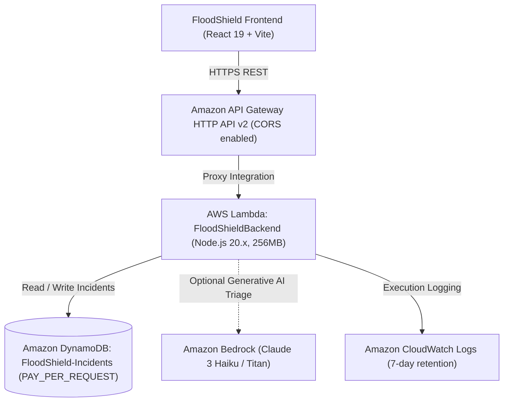

# FloodShield — AWS Serverless Backend Architecture & Deployment Guide

This directory contains the production-ready serverless backend for **FloodShield**, built with Amazon API Gateway (v2 HTTP API), AWS Lambda (Node.js 20 ES modules), Amazon DynamoDB (On-Demand billing), and Amazon Bedrock integration.

---

## 1. Architecture



---

## 2. API Endpoints Reference

All endpoints return standard CORS headers (`Access-Control-Allow-Origin: *`).

| Method | Endpoint | Description | Sample Request | Sample Response |
| :--- | :--- | :--- | :--- | :--- |
| `GET` | `/health` | Health & DynamoDB connectivity status | `curl https://<api-id>.execute-api.ap-south-1.amazonaws.com/health` | `{"status":"HEALTHY","region":"ap-south-1","database":{"connected":true}}` |
| `GET` | `/risk` | Multi-factor deterministic flood risk score | `curl "https://<api-id>.execute-api.ap-south-1.amazonaws.com/risk?lat=19.07&lng=72.87&rainfall=45"` | `{"riskScore":62,"riskLevel":"HIGH","contributingFactors":[...]}` |
| `GET` | `/reports` | Fetch citizen incident radar records from DynamoDB | `curl https://<api-id>.execute-api.ap-south-1.amazonaws.com/reports` | `{"reports":[...],"total":4,"dataMode":"LIVE_AWS_DYNAMODB"}` |
| `POST` | `/reports` | Submit citizen flood incident with validation | `curl -X POST https://<api-id>.execute-api.../reports -H 'Content-Type: application/json' -d '{"title":"Street Flood","description":"50cm water","severity":"HIGH"}'` | `{"success":true,"ticket":{"id":"INC-171829...","status":"UNVERIFIED"}}` |
| `POST` | `/reports/status` | Update incident triage status (Verifying / Dispatched) | `curl -X POST https://<api-id>.../reports/status -d '{"id":"INC-...","status":"VERIFIED"}'` | `{"success":true,"report":{"id":"...","status":"VERIFIED"}}` |
| `POST` | `/assess` | Response Copilot AI triage & decision support | `curl -X POST https://<api-id>.../assess -d '{"prompt":"Assess underpass flood risk"}'` | `{"success":true,"provider":"Amazon Bedrock","advice":"...","evidence":{...}}` |
| `POST` | `/scenarios/simulate` | Hydrodynamic simulation calculations | `curl -X POST https://<api-id>.../scenarios/simulate -d '{"rainfallRate":80,"surgeHeight":1.8}'` | `{"simulated":true,"outputs":{"peakDepthCm":92,"scenarioRiskLevel":"HIGH"}}` |

---

## 3. Cost Considerations & Free Tier Eligibility

- **Amazon DynamoDB**: Configured with `PAY_PER_REQUEST` (On-Demand). AWS provides **25 GB of storage and 25 write/read capacity units per month permanently free**. Idle cost is **$0.00**.
- **AWS Lambda**: Configured with 256MB memory and 15s timeout. AWS Free Tier includes **1,000,000 free requests and 400,000 GB-seconds of compute time per month**.
- **Amazon API Gateway (HTTP API v2)**: AWS Free Tier provides **1,000,000 API calls per month for free** for 12 months, and costs only $1.00 per million calls thereafter.
- **Amazon CloudWatch Logs**: Log groups have a strict **7-day expiration policy** to prevent indefinite storage accumulation.
- **Amazon Bedrock**: Disabled by default (`ENABLE_BEDROCK=false`). When enabled, Claude 3 Haiku costs ~$0.00025 per 1,000 input tokens. If disabled, the backend automatically uses its high-fidelity deterministic triage engine at $0 additional cost.

---

## 4. One-Click Deployment Instructions

### Option A: Using PowerShell (Windows)
Open PowerShell in the project root:
```powershell
cd backend
.\deploy.ps1
```
*The script verifies your AWS CLI credentials, installs dependencies, packages and deploys the CloudFormation/SAM stack to `ap-south-1` (Mumbai), and automatically updates your root `.env` file with the deployed API endpoint!*

### Option B: Using AWS SAM CLI
```powershell
cd backend
npm install --production
sam build
sam deploy --guided
```
*(When prompted for parameters, select region `ap-south-1`, stack name `FloodShield-Backend-hackathon`, and allow unauthenticated HTTP API invocations).*

### Option C: Using AWS CLI Directly (CloudFormation)
```powershell
cd backend
npm install --production

# 1. Create S3 deployment bucket
aws s3 mb s3://floodshield-deploy-ap-south-1 --region ap-south-1

# 2. Package CloudFormation template
aws cloudformation package `
  --template-file template.yaml `
  --s3-bucket floodshield-deploy-ap-south-1 `
  --output-template-file packaged.yaml `
  --region ap-south-1

# 3. Deploy Stack
aws cloudformation deploy `
  --template-file packaged.yaml `
  --stack-name FloodShield-Backend-hackathon `
  --capabilities CAPABILITY_IAM `
  --region ap-south-1 `
  --parameter-overrides EnvironmentName=hackathon EnableBedrock=false

# 4. Get Deployed API Gateway URL
aws cloudformation describe-stacks `
  --stack-name FloodShield-Backend-hackathon `
  --region ap-south-1 `
  --query "Stacks[0].Outputs[?OutputKey=='ApiEndpointUrl'].OutputValue" `
  --output text
```

---

## 5. Security & Provenance Checks

1. **No Credentials in Frontend**: No AWS Secret Keys or IAM access keys exist anywhere in frontend code. All cloud access is proxied through the authenticated HTTP API Gateway.
2. **Strict Least-Privilege IAM**: The Lambda execution role has read/write permissions scoped strictly to the `FloodShield-Incidents-*` DynamoDB table and scoped CloudWatch log stream permissions.
3. **Explicit Data Provenance**: Every response includes `dataMode` labels (`LIVE_AWS_DYNAMODB`, `LIVE`, `SIMULATED`, or `USER-REPORTED`), ensuring citizens and emergency responders know exactly what data has been verified.
